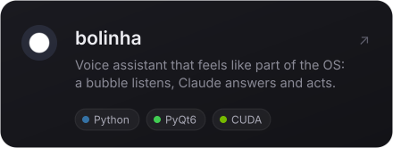
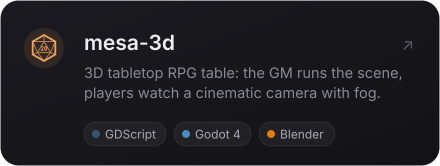
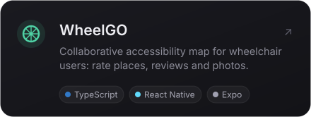

<h1 align="center">Hi there, I'm Enzo Rebello Miranda 👋</h1>

  I like building software that feels <b>native</b>: fast, quiet, and nice to look at. 
  From mobile apps to little tools that live in my Linux desktop.

  
  

---

## 🧑‍💻 About Me

- 🎓 **Information Systems** student at **USP** (University of São Paulo)
- 🏫 Technical high school in Web Development at **ETEC Dr. Emílio Hernandez Aguilar**, where I built WheelGO
- 📱 Building mobile apps with **React Native** and **Expo**
- 🐧 Daily driving **Linux** (CachyOS + Hyprland) and making it smarter, one tool at a time
- 🎲 Building **mesa-3d**, a cinematic 3D RPG table in **Godot** for my tabletop sessions
- 🫧 Right now: teaching **bolinha**, my desktop voice assistant, to see the screen and move windows

---

## 🚀 Featured Projects

  
  
  

---

## 📊 GitHub Stats

  

---

## 🛠️ Tools & Technologies

<table align="center">
  <tr>
    <td align="center"><b>Languages</b></td>
    <td></td>
  </tr>
  <tr>
    <td align="center"><b>Frontend & Mobile</b></td>
    <td></td>
  </tr>
  <tr>
    <td align="center"><b>Games & 3D</b></td>
    <td></td>
  </tr>
  <tr>
    <td align="center"><b>Tools</b></td>
    <td></td>
  </tr>
</table>

---

## 🐍 My Commits

  

---

Made with 🤍 by Enzo Rebello Miranda · stats and snake redrawn every day by GitHub Actions

