# Hi there, I'm Enzo Rebello Miranda 👋

---

## 🧑‍💻 About Me

- 🎓 Information Systems student at USP (University of São Paulo)
- 🏫 Technical high school in Web Development (Informática para Internet) at ETEC Dr. Emílio Hernandez Aguilar
- 🐧 Daily driving Linux (CachyOS + Hyprland) and building tools that make the desktop feel smarter
- 📱 Building mobile apps with React Native and Expo

---

## 🚀 Featured Projects

| | |
|---|---|
| 🫧 **[bolinha](https://github.com/remynzo/bolinha)** | A voice assistant that feels like part of the OS: press a shortcut, a little bubble listens, Claude answers. Local speech-to-text on the GPU, natural voices, animated styles and profiles. *Python · PyQt6* |
| ♿ **[WheelGO](https://github.com/remynzo/WheelGO)** | My technical school final project: a collaborative map where wheelchair users rate how accessible places are, with reviews and photos. *TypeScript · React Native* |
| 🐍 **[jogocobrinhajs](https://github.com/remynzo/jogocobrinhajs)** | A snake game for the browser. *JavaScript · PHP* |

---

## 🛠️ Tools & Technologies

### **Languages**

  

### **Frontend & Mobile**

  

### **Tools**

  

---

## 🐍 My Commits

  

---

## 🌐 Socials

  
  

---

 Made with 🤍 by Enzo Rebello Miranda 

